# SpendWise user manual

Everything you need, step by step: from "I have never run this" to using it every week.
No money knowledge or computer skills needed. If a word looks scary, look for it in
[Words you'll see](#words-youll-see) at the bottom.

**Contents**

1. [What SpendWise does](#1-what-spendwise-does)
2. [Start SpendWise on your computer (first time)](#2-start-spendwise-on-your-computer-first-time)
3. [Your first 10 minutes](#3-your-first-10-minutes)
4. [Every week (5 minutes)](#4-every-week-5-minutes)
5. [Every month](#5-every-month)
6. [When something goes wrong (salary late, emergency)](#6-when-something-goes-wrong)
7. [Saving prices from shops (browser extension)](#7-saving-prices-from-shops-browser-extension)
8. [Savings & investing](#8-savings--investing)
9. [Settings](#9-settings)
10. [On your phone](#10-on-your-phone)
11. [Stop, restart and update SpendWise](#11-stop-restart-and-update-spendwise)
12. [Problems and fixes](#12-problems-and-fixes)
13. [Words you'll see](#words-youll-see)

---

## 1. What SpendWise does

You tell SpendWise:

* **what money you have** (bank accounts),
* **what comes in** (salary),
* **what must go out** (rent, bills, EMIs),
* **what you want to buy** — sorted into **needs** (must have), **wants** (nice to have) and
  **desires** (dreams).

SpendWise then tells you **when** to buy each thing so that you always keep an
**emergency reserve** (savings for bad days) — **even if your salary comes late**.

It never spends money for you and never connects to your bank. It only plans and explains.

---

## 2. Start SpendWise on your computer (first time)

You do this **once**. It takes about 15 minutes, most of it waiting for downloads.

### Step 1 — Install Docker Desktop

Docker is a free program that runs SpendWise for you, with everything it needs inside.

1. Go to <https://www.docker.com/products/docker-desktop/> and download **Docker Desktop**
   for your computer (Windows, Mac or Linux).
2. Install it like any other program (keep clicking **Next / OK**). On Windows, if it asks
   about **WSL 2**, say yes and restart the computer.
3. Open **Docker Desktop** and wait until it says **"Engine running"** (bottom-left).
   Leave it open.

> Docker Desktop needs about **10 GB** of free disk space. If your C: drive is full,
> in Docker Desktop go to *Settings → Resources → Advanced* and move the disk image to
> another drive.

### Step 2 — Download SpendWise

**Easy way (no Git):**

1. Open <https://github.com/Thrya29/SpendWise-AI-an-Adaptive-Purchase-Planning-and-Financial-Resilience-Engine>
2. Click the green **Code** button → **Download ZIP**.
3. Right-click the downloaded ZIP → **Extract All…** → choose a folder, for example
   `D:\SpendWise`.

**With Git (if you have it):**

```bash
git clone https://github.com/Thrya29/SpendWise-AI-an-Adaptive-Purchase-Planning-and-Financial-Resilience-Engine.git SpendWise
```

### Step 3 — Open a terminal in that folder

* **Windows:** open the SpendWise folder in File Explorer, click the address bar, type
  `powershell` and press **Enter**. A blue/black window opens — that's the terminal.
* **Mac:** open *Terminal*, type `cd ` (with a space), drag the SpendWise folder into the
  window, press **Enter**.

### Step 4 — Create your secret settings (one command)

Type this and press **Enter**:

```bash
python scripts/generate_env.py
```

It creates a file called `.env` with random passwords that only your computer knows.
(If it says *python not found*, install Python from <https://www.python.org/downloads/>
and tick **"Add python to PATH"** during install. On Mac, use `python3` instead of `python`.)

### Step 5 — Start SpendWise

```bash
docker compose up --build -d
```

The first time this downloads and builds everything — **5 to 10 minutes**. You'll see lots
of text; that's normal. When it finishes and you get your prompt back, open your browser at:

## 👉 <http://localhost:3000>

That's it. SpendWise is running on your computer. Only you can see it.

---

## 3. Your first 10 minutes

### 3.1 Create your account

Click **Create account**. Type your name, email, a password (at least 10 characters), your
country, city, main currency and time zone. Click **Create account**.

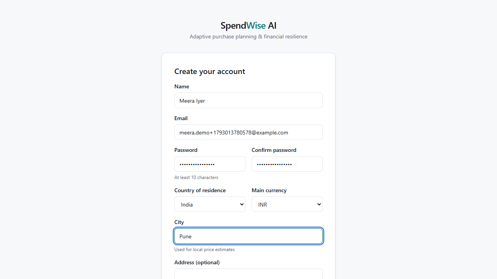

You land on your **Dashboard**. A new account shows four steps to get started.
The fastest way to do them all is **importing a bank statement**.

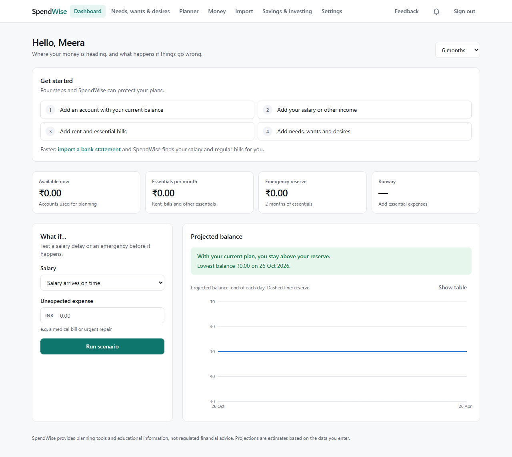

### 3.2 Import a bank statement (recommended)

1. In your bank's **net banking** website, download your statement as **CSV** (or Excel, then
   *Save as* CSV) for the **last 3 to 6 months**.
2. In SpendWise click **Import** (top menu) → **Choose file** → pick the CSV → **Read statement**.
3. **Check it was read correctly.** SpendWise compares every row with your bank's running
   balance. A green tick means everything adds up.

   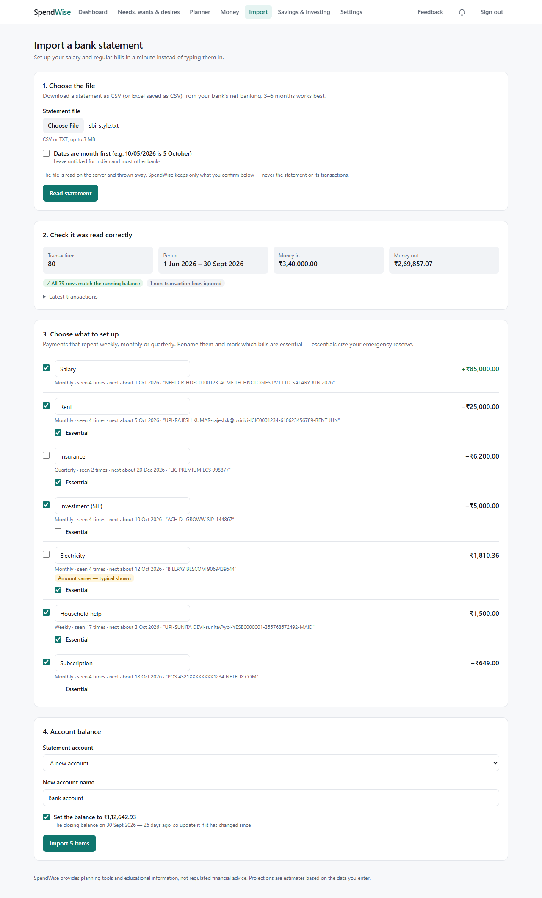

4. **Choose what to set up.** SpendWise found your salary and regular bills (rent, EMIs,
   electricity, subscriptions, house help…). For each one:
   * tick it to add it, or untick to skip,
   * rename it if you like,
   * tick **Essential** for bills you can't skip (rent, EMI, electricity, school fees).
     Essentials decide how big your emergency reserve is.
5. **Account balance:** choose *A new account* (or an existing one) and keep
   *Set the balance to…* ticked.
6. Click **Import**.


> 🔒 The statement file is read and then thrown away. SpendWise keeps only what you ticked.

**No statement?** Go to **Money** and add things by hand: **Add account** (your current
balance), **Add income** (salary and its date), **Add expense** (rent, bills…).

### 3.3 Check your Money page

**Money** shows your accounts, income and recurring expenses. You can **Edit** or **Delete**
any row at any time.

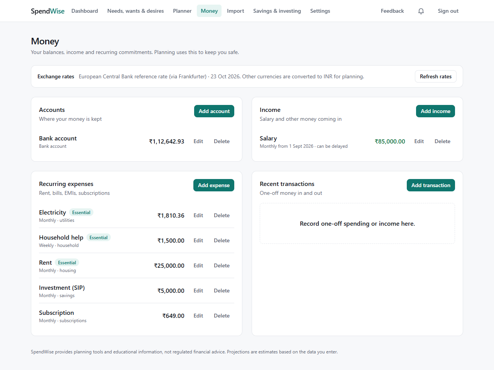

### 3.4 Add what you plan to buy

Go to **Needs, wants & desires**.

**The quick way:** type it in your own words in *Describe it in your own words*, e.g.
`Work laptop for 75k by 15 Dec, must have`, and click **Fill in for me**. Check the form and
click **Add item**.

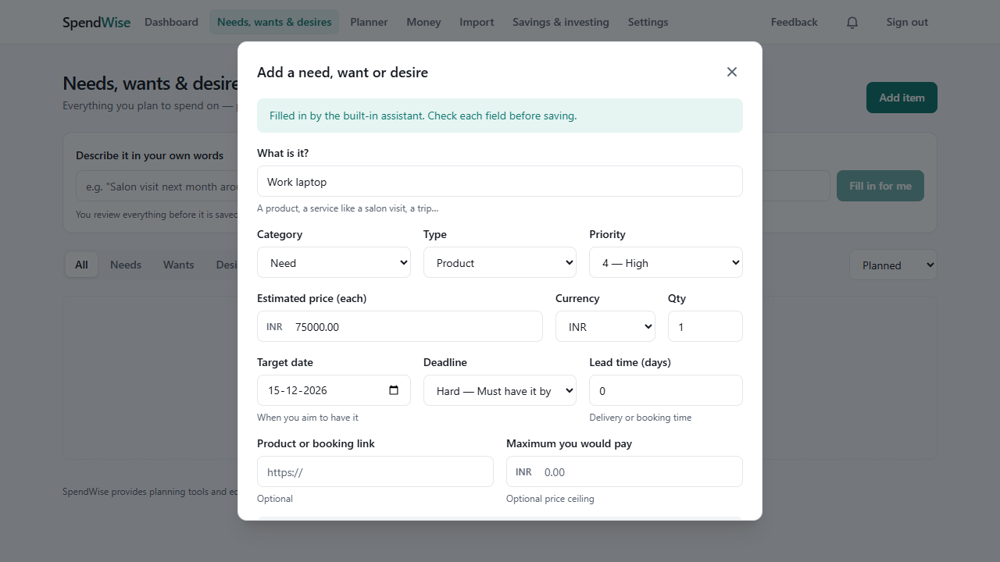

**The normal way:** click **Add item** and fill in:

| Field | What to put |
|---|---|
| **What is it?** | e.g. *Laptop*, *School fees*, *Goa trip* |
| **Category** | **Need** (must have), **Want** (nice to have), **Desire** (a dream) |
| **Type** | product, service, travel, experience, subscription or other |
| **Priority** | 5 = most important |
| **Estimated price** | your best guess; you can update it later |
| **Target date** | when you need it (leave empty if any time is fine) |
| **Deadline** | **Hard** = must have by then, **Soft** = preferred, **Flexible** = whenever |
| **Product or booking link** | optional; lets SpendWise check the price |
| **Maximum you would pay** | optional; SpendWise waits until the price is at or below this |

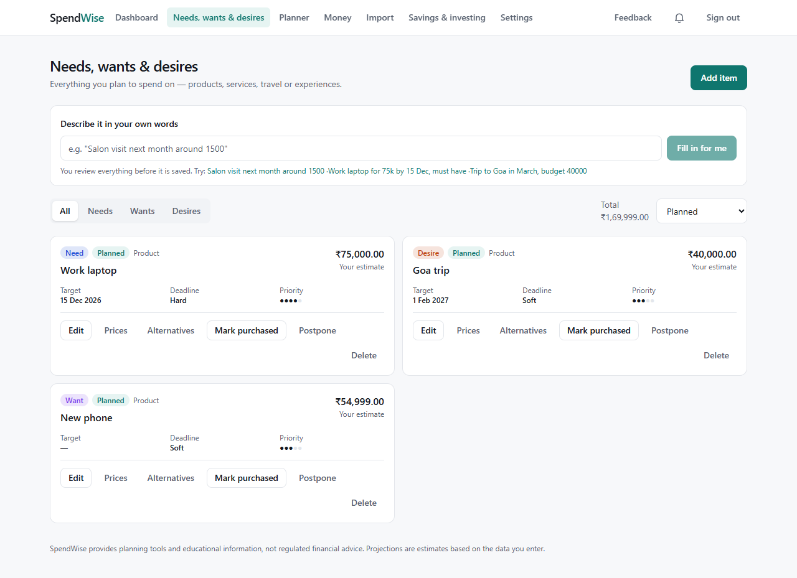

### 3.5 Look at your Dashboard

The **Dashboard** shows your balance for every day of the next months, with all your bills,
salary and planned purchases. The **dashed line** is your emergency reserve: staying above it
means you're safe.

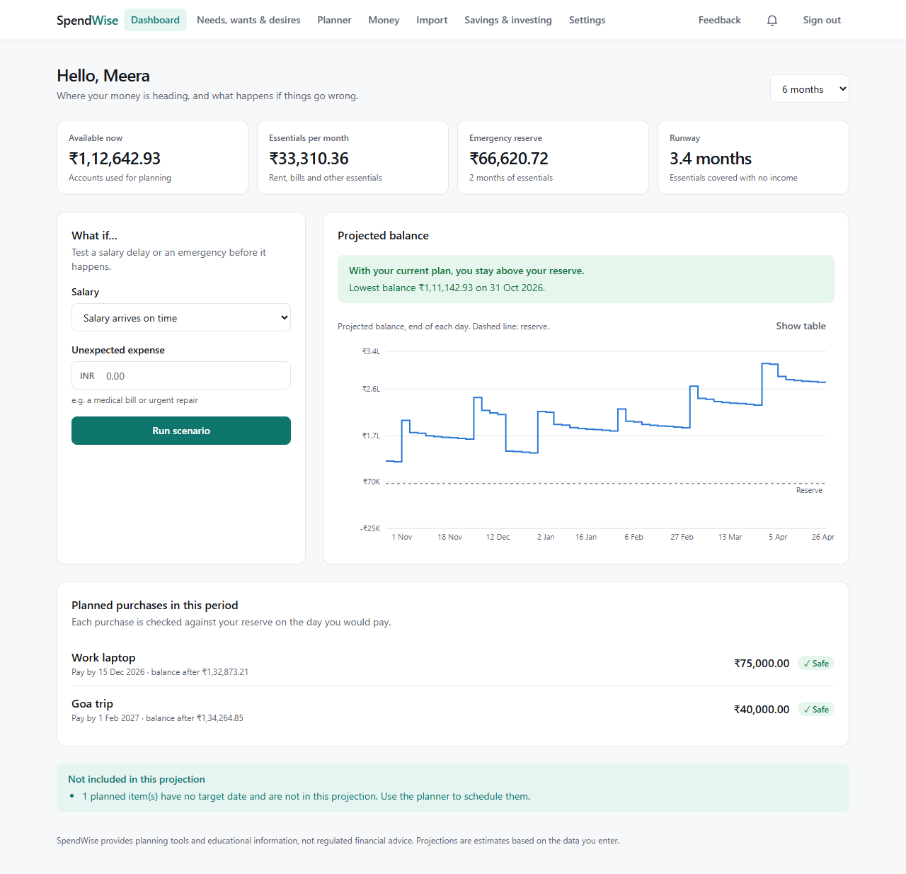

**Try "What if…"** (left side): choose *Salary 2 months late* or type an unexpected expense,
then click **Run scenario**. You'll see exactly when you'd run short — before it happens.

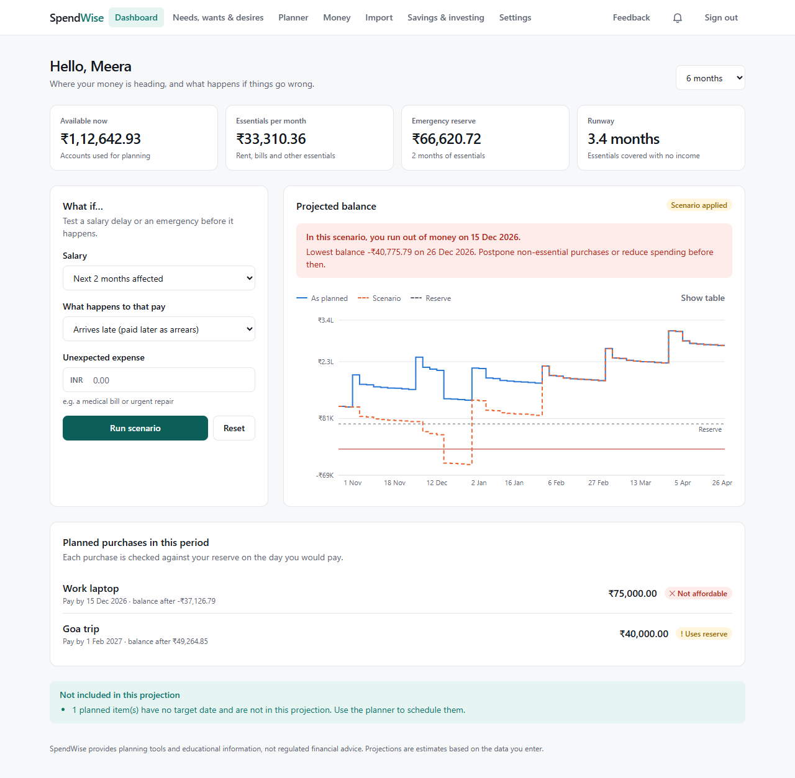

### 3.6 Run the planner

Go to **Planner**:

1. **Look ahead:** how many months to plan (6 is good).
2. **Stay safe even if…:** tick the bad things you want to be ready for. *Salary 1 month late*
   is ticked by default.
3. Click **Run planner**.

You get one decision per item, each with a plain reason:

| Decision | Meaning |
|---|---|
| **Buy now** | Safe to buy today |
| **Scheduled** | Buy on the date shown to stay safe |
| **Needs your approval** | Only possible on time by using part of your reserve — you decide |
| **Postponed** | Not safe within this time; shows exactly how much more money is needed |
| **Waiting for a better price** | Price is above your limit; shows the chance it drops in time |
| **Covered by an alternative** | You linked two options; the plan picks the best one |

If a deadline can only be met when salary arrives on time, you'll see an orange box with the
exact risk and a **Pay on time anyway** tick-box. It's your choice.

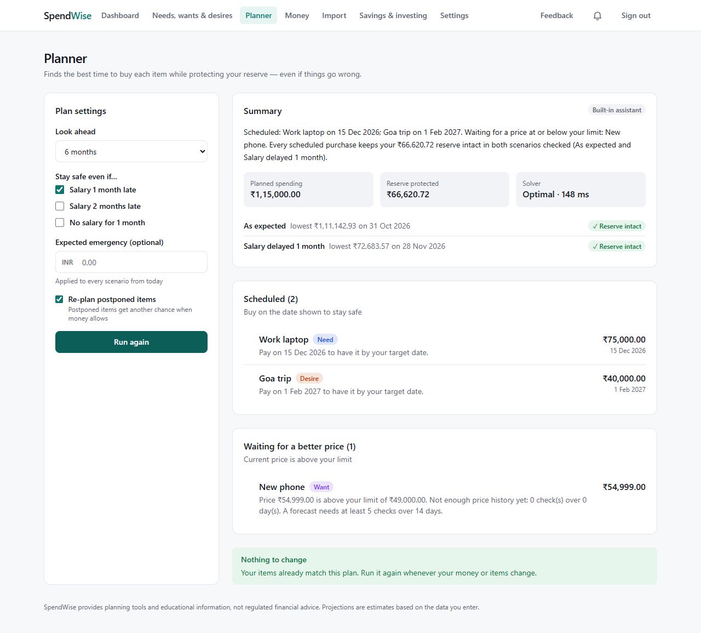

4. Tick the changes you agree with and click **Apply**. **Nothing changes until you do.**

---

## 4. Every week (5 minutes)

1. **Open SpendWise and sign in.**
2. **Dashboard:** is there a yellow or red banner? It tells you what's at risk and when.
3. **Alerts** (🔔 bell, top right): bills you can't cover in the next 3 days, purchases planned
   for today, "did your salary arrive?", and price drops.

   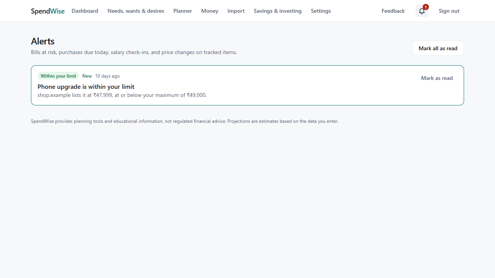

4. **Bought something?** On **Needs, wants & desires**, click **Mark purchased**.
5. **Saw a new price?** Click **Prices** on the item to see its price history and the chance
   it gets cheaper before you need it. Record a quote from a local shop there too.

   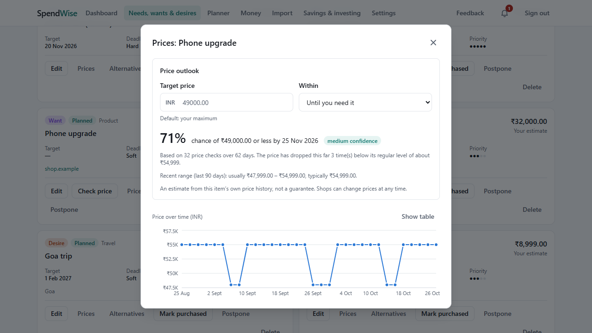

6. **Two options for the same thing** (e.g. premium vs budget headphones)? Click
   **Alternatives** and link them. The planner buys only the best one.

   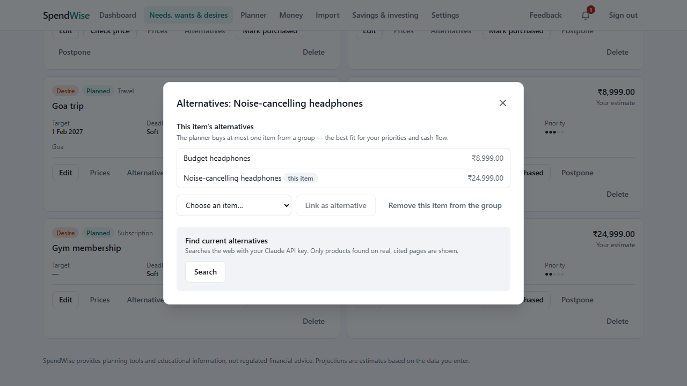

7. **Anything changed?** Run the **Planner** again and apply what you agree with.

   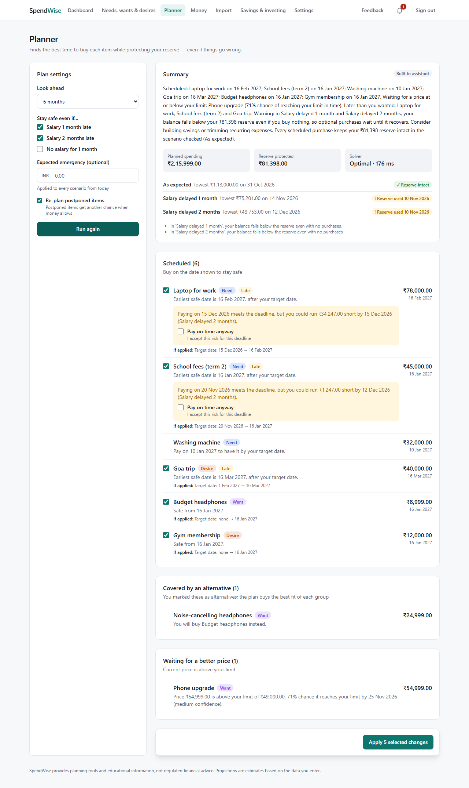

---

## 5. Every month

* **Update your balance:** on **Money**, edit your account to today's balance (or import a
  fresh statement — SpendWise skips what's already set up).
* **Check-in:** at the start of each month the dashboard asks *"How did last month go?"* —
  three quick questions. They help show whether SpendWise is really helping.
* **Look ahead:** run the planner with *Look ahead: 12 months* for big things (trips, school
  fees, festivals).

---

## 6. When something goes wrong

**Salary is late:**

1. Go to **Planner**, tick **Salary 1 month late** (or 2 months), click **Run planner**.
2. Apply the safe dates. Postponed items come back automatically when money allows.
3. On the **Dashboard**, *What if… → Salary arrives late* shows when you'd run short.

**An emergency (hospital, repair):**

1. On **Money**, click **Add transaction** and record what you paid.
2. Run the **Planner** again — it re-plans everything around the smaller balance.

**Lost your job:** on the Dashboard, *What if… → Never arrives* shows how long your money lasts
("Runway"). The planner keeps only what's still safe.

---

## 7. Saving prices from shops (browser extension)

Big shops like Amazon and Flipkart block automatic price checks. The **Save to SpendWise**
browser extension reads the price from the page **you** are looking at, and you confirm it.
Works in **Chrome** and **Edge** on a computer.

**Install (once):**

1. In Chrome go to `chrome://extensions` (Edge: `edge://extensions`).
2. Turn on **Developer mode** (top right).
3. Click **Load unpacked** → choose the `extension` folder inside your SpendWise folder.
4. Click the puzzle-piece icon in the toolbar and **pin** *Save to SpendWise*.

**Connect (once):**

1. In SpendWise: **Settings → Browser extension → Create a key**. Copy the key (it's shown
   only once).

   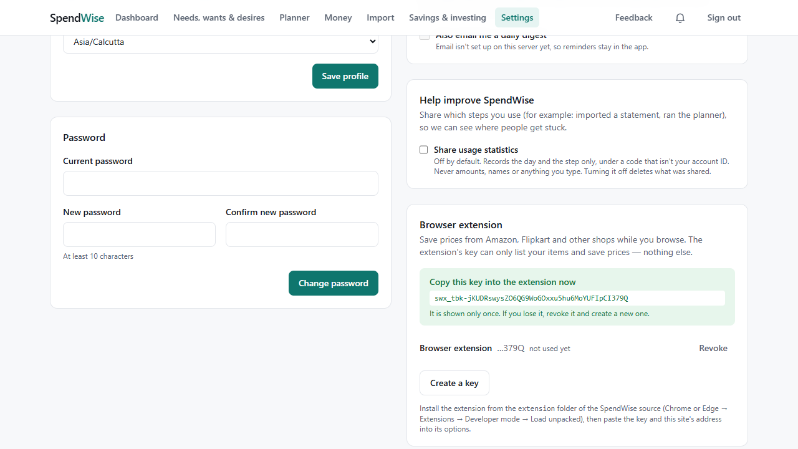

2. Right-click the extension icon → **Options**. Address: `http://localhost:3000`. Paste the
   key. Click **Save and test** and allow the permission.

**Use:**

1. Open any product page. Click the SpendWise icon.
2. It shows the name and price it found and **where** it found them. Fix anything.
3. Choose **New item** (pick Need/Want/Desire) or **Existing item**, then **Save to SpendWise**.

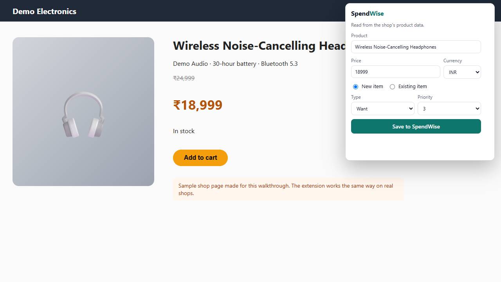

> The extension reads a page only when you click it. It sends the name, link and price only to
> your SpendWise. Revoke the key any time in Settings.

---

## 8. Savings & investing

Learning tools that use your own numbers. **SpendWise never tells you what to buy.** For
personal advice, talk to a SEBI-registered investment adviser.

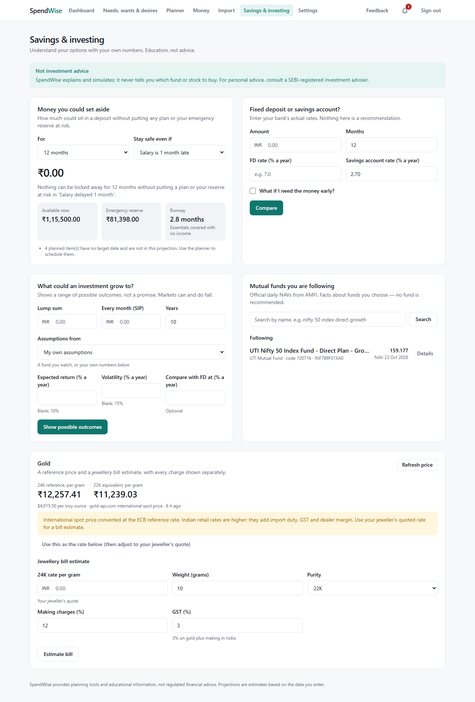

| Card | What it tells you |
|---|---|
| **Money you could set aside** | How much could go into a fixed deposit without risking your plans or reserve |
| **Fixed deposit or savings account?** | Type your bank's real rates; see exactly what each gives, even if you break the FD early |
| **What could an investment grow to?** | A range of outcomes for an SIP or lump sum — weak, middle and strong markets, and the chance of a loss |
| **Mutual funds you are following** | Search any fund by name; see its official NAV and how it behaved in the past |
| **Gold** | Today's reference price (lower than shop prices — the app says why) and a jewellery bill with every charge |

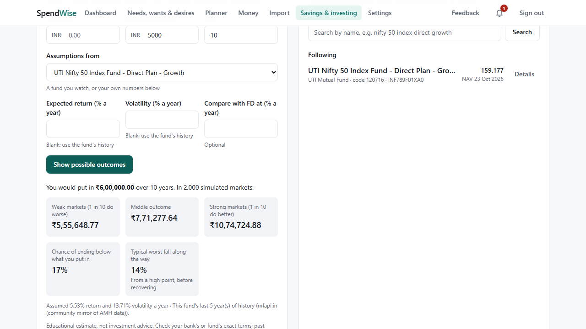

---

## 9. Settings

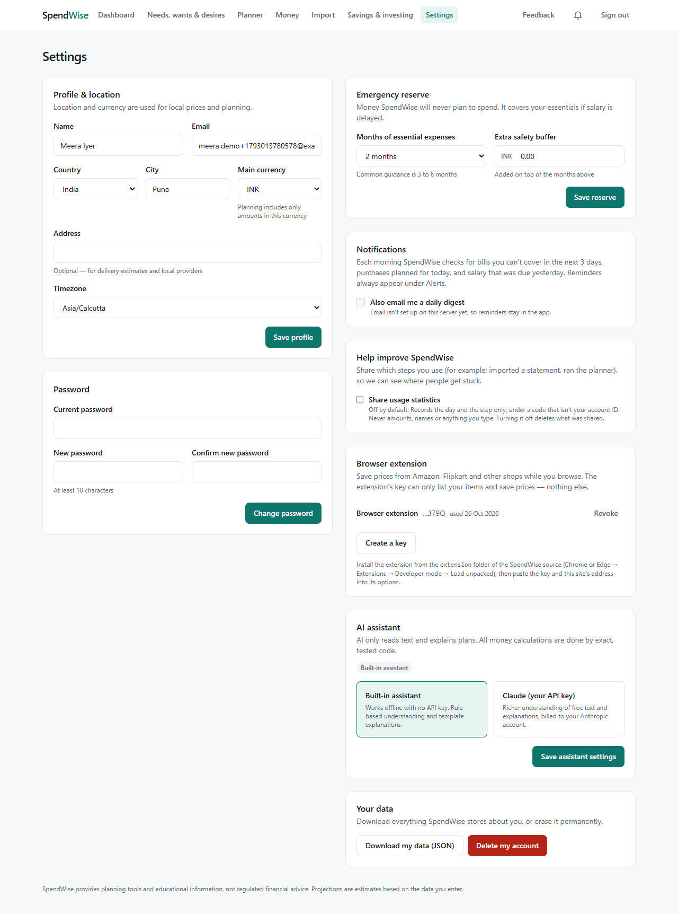

* **Profile & location** — name, country, city, currency, time zone.
* **Emergency reserve** — how many months of essential bills to always keep (2 is the
  default; 3–6 is safer).
* **Notifications** — reminders always appear under Alerts; tick to also get one email a day
  (only if your SpendWise has email set up).
* **Help improve SpendWise** — optional, off by default. Shares only which steps you used.
* **Browser extension** — create or revoke keys.
* **AI assistant** — **Built-in** works with no internet key. **Claude (your API key)** gives
  richer text; paste your key from <https://console.anthropic.com>. Money maths is always done
  by exact code, never by AI.
* **Your data** — download everything as a file, or delete your account forever.

---

## 10. On your phone

SpendWise works in your phone's browser. To use it like an app: open it in Chrome (Android) or
Safari (iPhone) → menu → **Add to Home screen**.

| | |
|---|---|
| 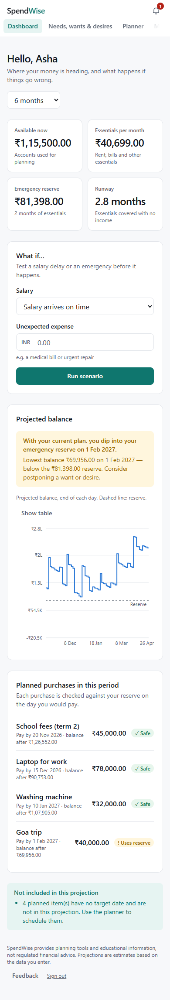 | 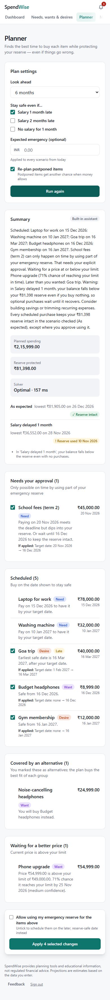 |

> Your phone can only open SpendWise if it can reach the computer running it — for example
> when it's deployed on a server ([deployment guide](DEPLOYMENT.md)).

---

## 11. Stop, restart and update SpendWise

Open the terminal in the SpendWise folder (see [Step 3](#step-3--open-a-terminal-in-that-folder)).

| I want to… | Type |
|---|---|
| Stop SpendWise | `docker compose stop` |
| Start it again | `docker compose start` (or `docker compose up -d`) |
| See if it's running | `docker compose ps` (everything should say *healthy*) |
| Update to the newest version | `git pull` then `docker compose up --build -d` (ZIP users: download the new ZIP, copy your old `.env` into it, then `docker compose up --build -d`) |
| Make a backup | `scripts/backup.sh` (Mac/Linux) — see the [deployment guide](DEPLOYMENT.md#3-backups) |

Your data stays safe when you stop, start or update. It's only deleted with
`docker compose down --volumes` — **don't type that** unless you really want to erase everything.

---

## 12. Problems and fixes

| Problem | Fix |
|---|---|
| `docker: command not found` | Docker Desktop isn't installed or isn't open. Open it and wait for *Engine running*. |
| `.env already exists` | That's fine — you already did Step 4. Go to Step 5. |
| The page `localhost:3000` doesn't open | Wait a minute and refresh. Then run `docker compose ps`; if something isn't *healthy*, run `docker compose logs --tail 50` and look for the error. |
| Port 3000 is already used | Open `.env`, change `WEB_PORT=3000` to `WEB_PORT=3001`, run `docker compose up -d`, open `http://localhost:3001`. |
| "Could not find the transaction table" when importing | The file isn't a CSV statement. Download CSV (or Excel → Save as CSV) from net banking. PDF isn't supported. |
| Rows "don't add up" after import | Check the amounts and signs on the preview before importing; some banks export unusual formats. |
| The extension says *Can't reach* | Is SpendWise running? Is the address in the extension's options exactly the one you open (e.g. `http://localhost:3000`)? |
| The extension says the key was revoked | Create a new key in Settings and paste it into the extension's options. |
| Forgot your password | There's no email reset on a local install. Ask whoever runs your SpendWise, or create a new account. |

---

## Words you'll see

| Word | Meaning |
|---|---|
| **Need / Want / Desire** | Must have / nice to have / a dream. Needs are planned first. |
| **Emergency reserve** | Money SpendWise never plans to spend: a few months of essential bills, for bad days. |
| **Essential** | A bill you can't skip (rent, EMI, electricity, school fees). |
| **Runway** | How many months your money lasts if no salary comes. |
| **Hard / soft deadline** | Must have by the date / would like it by the date. |
| **Scenario** | A "what if" — e.g. salary 1 month late. |
| **Planner** | The part that decides the safest time to buy each thing. |
| **SIP** | Systematic Investment Plan: investing a fixed amount every month. |
| **FD** | Fixed deposit: money locked in a bank for a fixed time at a fixed rate. |
| **NAV** | The price of one unit of a mutual fund, published daily. |
| **Extension key** | A password just for the browser extension. It can only save prices. |
